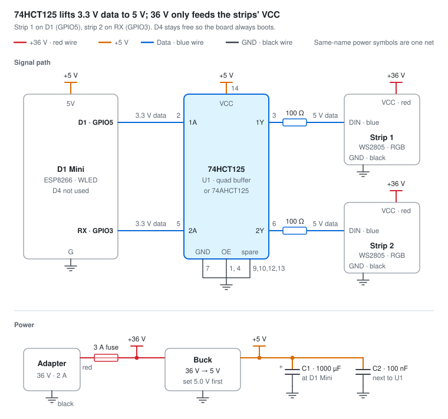
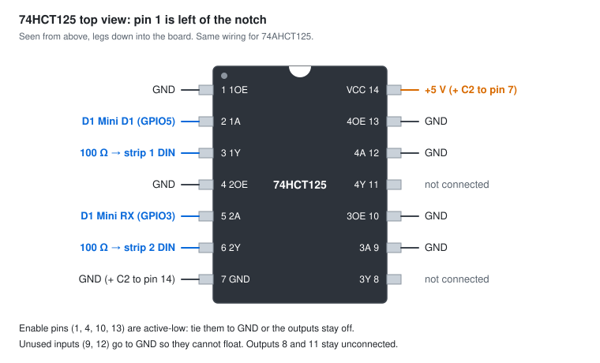

# eufy E22 permanent outdoor lights → WLED → Home Assistant

Replace the cloud-only eufy control unit with a D1 Mini running [WLED](https://kno.wled.ge/). You get fully local control, every LED addressable, a native [Home Assistant](https://www.home-assistant.io/integrations/wled/) integration, and instant motion lighting with no eufy app or cloud.

The whole controller is about €10 of parts: a D1 Mini, a 74HCT125 buffer chip, a 36 V → 5 V buck module and a few passives. The original eufy power adapter and light strings are reused unchanged.

The story behind the build: [I freed my eufy E22 outdoor lights from the cloud](https://ko-fi.com/post/I-freed-my-eufy-E22-outdoor-lights-from-the-cloud-U5N729C9U9). If this guide helps you, [buy me a coffee on Ko-fi](https://ko-fi.com/nerijuscode) ☕

> [!WARNING]
> DIY project, at your own risk. Opening or replacing the control unit voids the eufy warranty. The strings run on 36 V DC: not dangerous to touch, but it destroys a D1 Mini instantly if it reaches a GPIO pin.
> This project is not affiliated with or endorsed by eufy or Anker; "eufy" is used only to describe compatibility.

## Contents

1. [How it works](#how-it-works)
2. [What was tested](#what-was-tested)
3. [E22 wiring and LED type](#e22-wiring-and-led-type)
4. [Parts list](#parts-list)
5. [Schematic and 74HCT125 pinout](#schematic-and-74hct125-pinout)
6. [Build it](#build-it)
7. [Flash WLED](#flash-wled)
8. [Configure WLED](#configure-wled)
9. [Add it to Home Assistant](#add-it-to-home-assistant)
10. [Motion lighting](#motion-lighting)
11. [Outdoor installation](#outdoor-installation)
12. [Troubleshooting](#troubleshooting)
13. [What didn't work, and why](#what-didnt-work-and-why)

## How it works

The E22 strings are ordinary addressable LEDs with a 36 V supply line. Each string has three wires: 36 V, ground and one data line (DIN). The eufy control unit only switches the 36 V and sends data. You replace it with:

- **D1 Mini (ESP8266) running WLED.** It generates the LED data and talks to Home Assistant over Wi-Fi.
- **74HCT125 buffer.** It turns the D1 Mini's 3.3 V data into the clean 5 V signal the strings need, and it shields the D1 Mini from the strings.
- **Buck converter.** It makes 5 V for the D1 Mini and the buffer from the eufy 36 V adapter.

36 V goes only to the strings' VCC wire. Nothing on the D1 Mini side ever sees it.

## What was tested

| Item | Value |
| --- | --- |
| Lights | eufy Permanent Outdoor Lights E22, model T8L02 |
| Control unit label | Input 36 V ⎓ 2.0 A, LED power 10 W per 5 m string |
| LEDs | 10 per 5 m string, individually addressable |
| Controller | BerryBase D1 Mini (ESP8266) |
| Firmware | WLED 16.0.1, ESP8266 build |
| LED type in WLED | WS2805 (RGB + warm white + cool white), colour order RGB |
| Outputs | 2 independent strips: D1 (GPIO5) and RX (GPIO3) |

## E22 wiring and LED type

**Power adapter cable**

| Wire | Signal |
| --- | --- |
| Red | +36 V |
| Black | GND |

**LED string connector**

| Wire | Signal | Notes |
| --- | --- | --- |
| Red | +36 V (VCC) | LED power only |
| Blue | DIN (data) | Rests at 0 V and expects 5 V logic pulses. **Never connect it to 36 V** |
| Black | GND | Common ground |

**LED protocol:** WLED type **WS2805**, colour order **RGB**, 10 LEDs per 5 m string. Plain WS281x also lights the RGB LEDs but leaves the two white channels unused.

**How to tap the string without cutting it:** use the original control unit's output cable (cut off the eufy box and keep the plug), or a third-party E22 (T8L02) male splice or extension connector.

**The original control unit,** for reference: FCC ID 2AOKB-T8L02. It uses an AltoBeam ATBM6441 Wi-Fi chip and an Actions ATS2835P Bluetooth chip; neither is an ESP, so the stock board **cannot be reflashed** with WLED or ESPHome. An NP35P06 P-MOSFET switches the 36 V to the strings, and the output pads are labelled VCC, GND and DIN.

## Parts list

| Part | Qty | Notes |
| --- | --- | --- |
| D1 Mini, ESP8266 | 1 | Any D1 Mini clone. An ESP32 D1 Mini also works with different pins |
| **74HCT125** or **74AHCT125**, DIP-14 | 1 | Must be the **HCT/AHCT** version: the plain 74HC125 does not reliably read 3.3 V as "high" |
| DIP-14 socket | 1 | Makes the chip replaceable |
| Buck converter, 36 V → 5 V | 1 | Input rating **≥ 40 V**: LM2596**HV** or XL7015 modules. MP1584 (28 V max) and XL4015 (38 V max) modules will fail |
| 100 Ω resistor | 2 | In series with each DIN output |
| 1000 µF electrolytic, ≥ 10 V | 1 | C1, across the D1 Mini's 5V and G. Keeps Wi-Fi stable |
| 100 nF ceramic | 1 | C2, directly across U1 pins 14 and 7 |
| Inline fuse holder + 3 A fuse | 1 | In the 36 V line |
| eufy 36 V / 2 A adapter | 1 | The original one, reused |
| E22 connectors or pigtails | 2 | One per strip (see above) |
| Perfboard, wire, headers | — | 0.75 mm² or thicker for 36 V and GND |
| IP65 **plastic** junction box + cable glands | 1 | A metal box blocks Wi-Fi |

**Do not use** an IRLZ44N or other MOSFET with a 36 V pull-up, the blue "bidirectional level shifter" boards (BSS138), TXS0108/TXB0104 auto-direction translators, or any 4000-series chip (CD4013, CD4050). See [What didn't work](#what-didnt-work-and-why).

Interchangeable buffers: 74HCT125, 74AHCT125, 74HCT126 (enable pins to 5 V instead of GND), 74HCT245 or 74AHCT245 (8 channels; DIR to 5 V, OE to GND), or one SN74AHCT1G125 per strip (SMD).

## Schematic and 74HCT125 pinout





**U1 (74HCT125) pin by pin**

| Pin | Name | Connect to |
| --- | --- | --- |
| 1 | 1OE | GND |
| 2 | 1A | D1 Mini **D1** (GPIO5) |
| 3 | 1Y | 100 Ω → strip 1 DIN (blue) |
| 4 | 2OE | GND |
| 5 | 2A | D1 Mini **RX** (GPIO3) |
| 6 | 2Y | 100 Ω → strip 2 DIN (blue) |
| 7 | GND | GND |
| 8 | 3Y | Not connected |
| 9 | 3A | GND |
| 10 | 3OE | GND |
| 11 | 4Y | Not connected |
| 12 | 4A | GND |
| 13 | 4OE | GND |
| 14 | VCC | +5 V (buck output) |

The enable pins (1, 4, 10, 13) are active-low: tie them to GND, or the outputs stay off.

**Power wiring**

- Adapter red (+36 V) → 3 A fuse → strips' red VCC wires and the buck input.
- Buck output, set to **5.0 V**, → D1 Mini **5V** pin and U1 pin 14.
- C1 (1000 µF, + to 5 V) across the D1 Mini's 5V and G pins. C2 (100 nF) straight across U1 pins 14 and 7.
- **Every ground is joined:** adapter black, buck GND, D1 Mini G, U1 pin 7 and the strips' black wires.

**Power budget:** the adapter gives 72 W and each 5 m string draws 10 W. That's 6 strings comfortably, 7 at most. For more, add a second adapter and join the grounds.

## Build it

1. **Power first.** Wire adapter → fuse → buck. With nothing else connected, turn the buck's trimmer until its output reads **5.0 V**.
2. **Solder the DIP-14 socket** and put C2 right across pins 14 and 7. Don't insert the chip yet.
3. **Fit the D1 Mini** with the antenna end (the zig-zag trace, opposite the USB port) **overhanging the board edge**, at least 1 cm from the buck module, wires and copper. Solder C1 across 5V and G.
4. **Wire the data path:** D1 → socket pin 2, RX → socket pin 5. Socket pins 3 and 6 each go through 100 Ω to the strips' blue DIN wires.
5. **Tie socket pins 1, 4, 7, 9, 10, 12 and 13 to GND,** and pin 14 to +5 V.
6. **Measure before inserting the chip** (adapter on, no strings connected, black probe on GND):

   | Measure at | Expect |
   | --- | --- |
   | D1 Mini 5V | 5.0 V |
   | D1 Mini 3V3 | 3.3 V |
   | Socket pin 14 | 5.0 V |
   | Socket pins 1, 4, 7, 9, 10, 12, 13 | 0 V |
   | Strip connector red | 36 V |
   | Strip connector blue (DIN) | 0 V. **If it reads 36 V, stop: a wire is shorted** |

7. **Unplug, insert the 74HCT125** (notch matching the socket), connect **one** string to output 1, and power up.

Never power the D1 Mini from USB and the buck at the same time.

## Flash WLED

Flash the bare D1 Mini over USB before you solder it in.

1. Connect it with a **data** USB cable. If no serial port appears on Windows, install the CH340 driver.
2. Open [install.wled.me](https://install.wled.me) in **Chrome or Edge**, pick the latest stable release, click **Install** and choose the port.
3. Join the **WLED-AP** Wi-Fi from your phone (password `wled1234`) and open `http://4.3.2.1`.
4. **Config → WiFi Setup:** enter your Wi-Fi, set an mDNS name (for example `e22-lights`), **change the AP password**, then Save & Connect.
5. In your router, give the D1 Mini a **DHCP reservation**, so its IP never changes.

After it's built in, update WLED over Wi-Fi (Config → Security & Updates) or from Home Assistant, not over USB. The D1 Mini's USB chip shares the RX pin, so USB traffic would show up on strip 2.

## Configure WLED

Open `http://e22-lights.local` → **Config → LED Preferences**.

| Setting | Output 1 (strip 1) | Output 2 (strip 2) |
| --- | --- | --- |
| Type | WS2805 | WS2805 |
| Color order | RGB | RGB |
| Length | 10 × number of strings | 10 × number of strings |
| GPIO | 5 | 3 |

Also set:

- **Enable automatic brightness limiter: off.** It assumes 5 V LEDs and gets 36 V strings wrong; the adapter is sized for full brightness.
- **Make a segment for each output: on.** Each strip then becomes its own light in Home Assistant.
- **Turn LEDs on after power up/reset: off,** so a power cut doesn't switch the lights on at night.
- **Config → WiFi Setup → Disable WiFi sleep: on.** It makes the ESP8266 respond much more reliably.
- **Config → Security & Updates:** lock OTA updates, change the OTA passphrase from `wledota`, and download a backup of the config.

**Shortcut through the API:** [`wled/led-outputs.json`](wled/led-outputs.json) holds the same output settings (in WLED's config, type 32 = WS2805 and order 1 = RGB). Edit `len` to your string count, then:

```sh
curl -X POST -H "Content-Type: application/json" -d @wled/led-outputs.json http://e22-lights.local/json/cfg
curl -X POST -H "Content-Type: application/json" -d '{"rb":true}' http://e22-lights.local/json/state   # reboot
```

**Pin notes:**

- WLED's docs say GPIO3 (RX) handles up to 100 LEDs, which is 10 strings.
- On the ESP8266, GPIO5 (D1) uses software timing. That was fine in testing, but if a long strip 1 flickers, move it to **D4 (GPIO2)**, which has a hardware driver. With the buffer in place D4 is safe at boot, because nothing loads the pin. This setup is untested.
- **Don't wire a string directly to D4.** The string's input holds the pin low, and the ESP8266 then won't boot.

## Add it to Home Assistant

WLED has a built-in Home Assistant integration that needs WLED 0.14.0 or newer.

1. **Settings → Devices & services.** WLED shows up under **Discovered**: click **Add**. If it doesn't, use **Add Integration → WLED** and enter the IP or `e22-lights.local`.
2. Open the device and rename the segment lights to `light.e22_strip_1` and `light.e22_strip_2`. Home Assistant names segments "Segment 1, 2…" and ignores names set in WLED.
3. If you change segments in WLED later, they update automatically. If they don't, use **⋮ → Reload** on the integration and delete any entities that show as unavailable.

You get a light per segment plus a master light, preset and palette selects, effect speed and intensity, and a firmware update entity.

**Limitation:** Home Assistant controls one colour model per segment, so you can't set RGB and the warm/cool whites independently from Home Assistant. Build the exact look in WLED, save it as a **preset**, and recall it from Home Assistant with `select.select_option`.

## Motion lighting

Use a **Zigbee PIR sensor** in Home Assistant (ZHA) for an instant, local trigger. For example, a Philips Hue Outdoor Motion Sensor (IP44, no Hue bridge needed) with a Home Assistant Connect ZBT-2 or SONOFF Dongle Plus MG24 coordinator.

The eufy T8910 motion sensor isn't recommended here: it reaches Home Assistant only through community integrations, and users report missed or delayed motion events.

Paste [`ha/motion-automation.yaml`](ha/motion-automation.yaml) into **Settings → Automations → Create → Edit in YAML** and replace the entity IDs. It turns both strips on at 3000 K after sunset and off 2 minutes after motion stops.

## Outdoor installation

- Mount the controller in an IP65 **plastic** box, ideally under an eave, with all cables entering through glands on the **bottom** and a drip loop on each cable.
- Add a silica gel pack against condensation.
- Check Wi-Fi in WLED's Info panel: aim for −75 dBm or better. If it's weaker, move the box or add an access point.
- Keep the eufy control unit. It puts the lights back to stock in a minute.

## Troubleshooting

| Symptom | Likely cause | Fix |
| --- | --- | --- |
| All LEDs black | Chip not in, OE pins not at GND, or wrong output pin in WLED | Check pins 1 and 4 at 0 V, pin 14 at 5 V, and the GPIO numbers in LED Preferences |
| All LEDs full white | Inverted or stretched data (a MOSFET driver, or the wrong LED type) | Use the 74HCT125 circuit; type WS2805 or WS281x |
| Colours swapped (red shows green) | Colour order | Set colour order to **RGB** |
| Only the first string lights | Length too short | Length = 10 × strings |
| Colours garbled or repeating every few LEDs | Wrong channel count | Use type WS2805 |
| D1 Mini won't boot or drops off Wi-Fi after wiring | Something loads D4 (GPIO2), D3 (GPIO0) or D8 (GPIO15) at boot | Use D1 and RX for data; keep the boot pins free |
| Wi-Fi weak or unstable after soldering | Antenna too close to copper, wires or the buck; 5 V ripple | Let the antenna end overhang; add C1; enable "Disable WiFi sleep" |
| Strip 2 shows garbage while USB is plugged in | USB chip shares RX | Unplug USB; update over Wi-Fi |
| Lights come on after a power cut | WLED boot setting | Turn off "Turn LEDs on after power up/reset" |
| WLED unavailable in Home Assistant | IP changed | DHCP reservation, then **Reconfigure** the integration |

## What didn't work, and why

These were all tried during development:

| Attempt | Result | Why |
| --- | --- | --- |
| IRLZ44N MOSFET pulling DIN down, with a pull-up to 36 V | Black | Inverts the signal: DIN must rest at 0 V |
| Same MOSFET, WLED type TM1829 (inverted output) | All LEDs full white | Polarity right, but the slow MOSFET stretches every bit into a "1" |
| D4 → 330 Ω → DIN, 3.3 V | Black | Too little voltage at DIN |
| D4 wired straight to DIN | D1 Mini stopped booting | GPIO2 must be high at boot, and the string pulls it low |
| RX wired straight to DIN, 3.3 V | Worked | No safety margin, and no protection if 36 V ever reaches DIN |
| **74HCT125 buffer** | **Works** | Correct polarity, full 5 V, fast edges; the D1 Mini's pins are unloaded |

The blue bidirectional level-shifter boards use weak 10 kΩ pull-ups and are too slow for LED data, and 4000-series chips (CD4013, CD4050) are too slow and too weak.

## Support

Questions or problems? [Open an issue](https://github.com/MisiusCode/eufy_e22_wled_ha/issues). If this saved you a few evenings, [a coffee on Ko-fi](https://ko-fi.com/nerijuscode) is much appreciated. Read the [project post on Ko-fi](https://ko-fi.com/post/I-freed-my-eufy-E22-outdoor-lights-from-the-cloud-U5N729C9U9) for the story behind it.

## References

- [WLED Quick Start](https://kno.wled.ge/basics/getting-started/) and [WLED settings](https://kno.wled.ge/features/settings/)
- [WLED-compatible LED types](https://kno.wled.ge/basics/compatible-led-strips/)
- [Home Assistant WLED integration](https://www.home-assistant.io/integrations/wled/)
